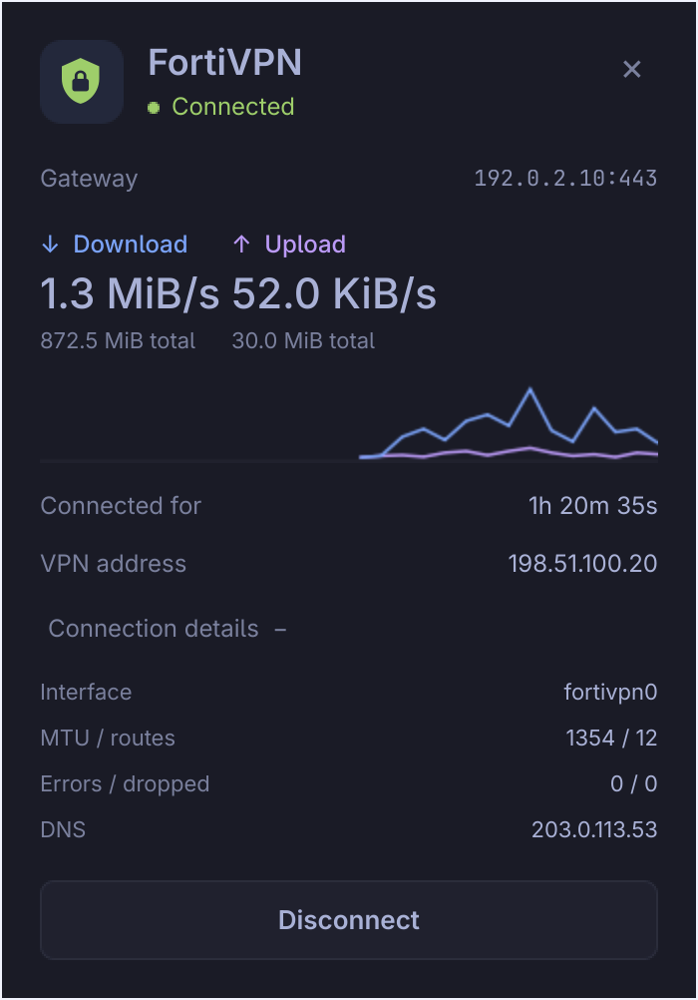

# FortiVPN for Omarchy

Connect to an OpenFortiVPN tunnel from the Omarchy bar. Enter an authentication token in the popup, see when the tunnel is connected, and keep an eye on its traffic.



- Connect, verify token, cancel, and disconnect.
- Live download/upload rates, transferred totals, and a recent traffic graph.
- Connection duration, VPN address, DNS, interface, MTU, routes, and packet counters.
- A background controller keeps the connection independent of terminals and bar reloads.
- The popup uses your Omarchy theme and runs inside its existing Quickshell process.

## Requirements

Omarchy Quattro with the Quickshell plugin API (`qs.Ui` and `qs.Commons`), Python 3, systemd, `openfortivpn`, `ppp`, and `iproute2`. A Nerd Font supplies the shield icon; Adwaita Sans and JetBrains Mono are preferred for text, with Qt font fallback when unavailable.

This plugin wraps an existing, working password-and-token OpenFortiVPN profile at `/etc/openfortivpn/config`. Configure and test that profile first using OpenFortiVPN's documentation. The file must be root-owned and mode `600`, with the correct gateway, credentials, and certificate validation settings. No VPN configuration is bundled or downloaded.

SAML/browser authentication, multiple profiles, and editing saved passwords in the panel are not supported in this release. English token prompts are recognized; the controller launches OpenFortiVPN with `LANG=C`. The requested PPP interface name is `fortivpn0`, which must be free before connecting.

## Install

Inspect the repository before enabling it. This is a community plugin, not an official Omarchy or Fortinet product.

```bash
omarchy plugin add https://github.com/fbal98/omarchy-fortivpn.git --enable
```

Install the required controller once, from the plugin directory. This command asks for your system password and grants the selected local account control of the fixed VPN profile:

```bash
cd ~/.config/omarchy/plugins/io.github.fbal98.fortivpn
sudo bash scripts/install-controller.sh --user "$(id -un)"
```

The installer creates a root-owned controller and systemd service. It does not change the VPN profile or the rest of your shell configuration. The service starts at boot; the VPN itself connects only when you choose **Connect**. There is no automatic privileged setup when the plugin is enabled.

The standard install command follows the current upstream branch. To inspect a fixed version, clone this repository, verify and check out a release commit, then run the controller installer from that checkout.

## Use

Click the shield beside your other bar controls, choose **Connect**, enter the current code when the gateway asks for it, and choose **Verify token** or press Enter. The status changes to **Connected** and the shield turns green once OpenFortiVPN reports the tunnel ready and its interface has an IPv4 address.

**Disconnect** asks OpenFortiVPN to restore its network settings before exiting. Closing the popup or restarting the bar leaves the background tunnel running. A token request expires after two minutes; reconnect to obtain a fresh request.

Expand **Connection details** for the link counters. Traffic rates and totals come from the tunnel interface; the graph shows recent samples collected while this widget is running. DNS shows the machine's current resolver entries, which are not necessarily exclusive to the VPN. Interface counters confirm local tunnel activity, not end-to-end reachability of every remote service.

The controller can recognize a directly launched default-profile OpenFortiVPN process with no endpoint overrides when its PPP peer matches the configured gateway IP. It does not take over arbitrary VPN profiles or hostname-based legacy tunnels.

## Update

```bash
omarchy plugin update io.github.fbal98.fortivpn
cd ~/.config/omarchy/plugins/io.github.fbal98.fortivpn
sudo bash scripts/install-controller.sh --user "$(id -un)" --replace
```

Updating the controller stops any tunnel it manages. Reconnect afterward. Restart the bar with `omarchy restart shell` if its component cache still shows the previous UI.

## Remove

Disconnect first, then remove the privileged controller before removing the plugin directory:

```bash
cd ~/.config/omarchy/plugins/io.github.fbal98.fortivpn
sudo bash scripts/uninstall-controller.sh
omarchy plugin remove io.github.fbal98.fortivpn
```

Removal preserves `/etc/openfortivpn/config`. Omarchy's plugin removal alone does not uninstall the separate system service.

## Privacy and permissions

The QML widget runs as your desktop user. The controller runs as root because PPP, routes, and DNS configuration require elevated privileges. It accepts only `status`, `connect`, `token`, and `disconnect` for one fixed profile, without caller-supplied commands or file paths.

The local Unix socket is mode `600`, owned by the account selected during installation, and also checks peer credentials. Tokens travel over that socket and OpenFortiVPN's stdin; the plugin does not save them or place them in process arguments. Raw VPN output is consumed in memory and is not copied into the journal. Saved VPN credentials remain in the existing root-only profile. The widget has no analytics or telemetry.

Local processes running as the selected account can control this VPN and inspect its status. Root can inspect process memory. OpenFortiVPN itself necessarily communicates with the configured gateway and may have its own logging or hooks configured by the administrator.

## Troubleshooting

- **Service unavailable:** check `systemctl status fortivpn-panel.service` and install the controller if needed. The widget retries when the service returns.
- **Profile configuration error:** ensure `/etc/openfortivpn/config` exists, is root-owned, has mode `600`, and works with OpenFortiVPN directly.
- **Certificate verification failed:** verify the gateway certificate with your VPN administrator and update your profile. This plugin does not disable TLS verification.
- **Token request expired:** choose **Connect** again and enter a fresh code.
- **Interface already in use:** disconnect the other `fortivpn0` tunnel before connecting.
- **UI stays on an older version:** run `omarchy restart shell`.

## Development and checks

```bash
omarchy plugin validate .
python3 -m unittest discover -s tests -p 'test_service.py' -v
python3 tests/test_qml_socket.py
bash -n scripts/install-controller.sh scripts/uninstall-controller.sh
```

The Python tests use fictional addresses and mocked VPN actions. The Quickshell socket test runs a separate **offscreen test harness**, not a second desktop shell, and checks recovery when its test service appears late. `preview.png` was rendered with fictional data; it is not a desktop screenshot or proof of a live connection.

The controller's token-request flow has been exercised against a live gateway. A completed live connection through this plugin has not yet been verified; there is no claim that mocked tests substitute for that check. Please report platform or authentication-flow compatibility issues without including credentials, tokens, or private endpoint details.

## License

MIT. Omarchy, Quickshell, OpenFortiVPN, Qt, and fonts are separately installed dependencies under their respective licenses; their source code and font files are not bundled. See [SECURITY.md](SECURITY.md) for the trust boundary and reporting guidance.
